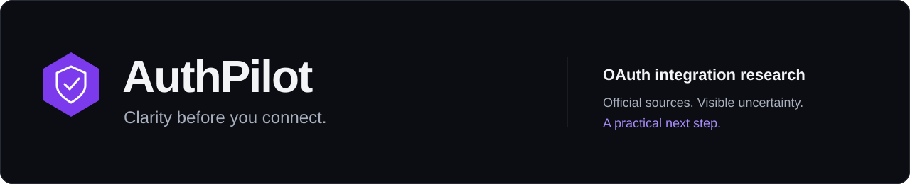
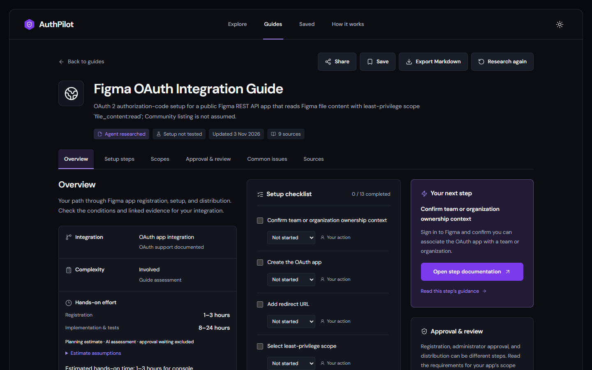
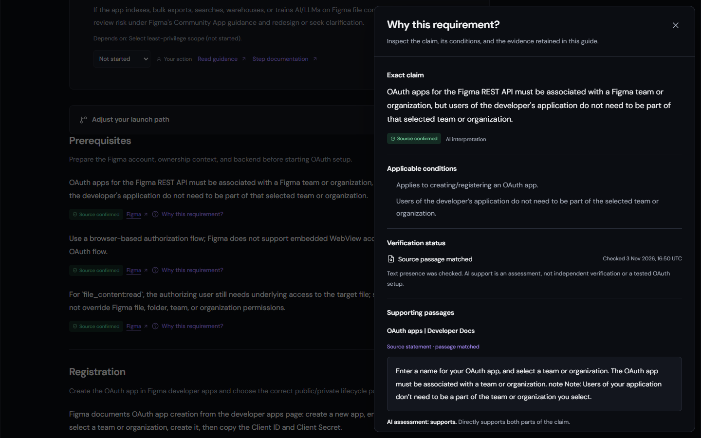
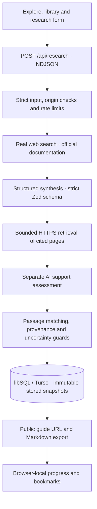

<div align="center">



**The intelligent OAuth integration navigator.**

Turn official documentation into a practical, source-linked plan for registering, configuring, testing, and distributing an OAuth integration.

[**Open the live demo ↗**](https://authpilot-navy.vercel.app) · [Quick start](#quick-start) · [Architecture](#architecture) · [Validation](#validation-and-real-results) · [Demo script](#a-three-minute-walkthrough)

Next.js App Router · TypeScript · Tailwind CSS · Radix UI · Zod · OpenAI Responses · Turso

</div>

---

## Clarity before the first callback

“Can I start building, or am I waiting on an administrator, a provider review, or a marketplace listing?”

OAuth documentation often mixes these paths together. AuthPilot separates them, makes uncertainty visible, and helps a developer choose the next action for their audience and scopes. It guides the developer-owned **OAuth app registration**, separately from an end user authorizing a connection.

**Try it directly:** [authpilot-navy.vercel.app](https://authpilot-navy.vercel.app). The hosted demo supports research without an account or access token. Research uses the operator’s server-side API key, with persistent limits of **five requests per client/network per hour** and **thirty per deployment per hour**. Visitors never supply credentials.

1. Explore a curated GitHub, Slack, or Google guide.
2. Enter another provider name or public website and choose a launch path.
3. Start real research; inspect its requirements, evidence, unknowns and checklist.

> **Scope:** AuthPilot researches documentation. The developer signs in, creates the OAuth client, protects credentials, runs integration tests and submits review materials. The provider decides approval.

## A workspace built around the next action



_Actual application capture from validation. Provider facts belong to the recorded research snapshot; no screenshot certifies completed OAuth setup._

| Experience                | What it helps you do                                                                                                     |
| ------------------------- | ------------------------------------------------------------------------------------------------------------------------ |
| **Provider library**      | Search, filter and sort guides; save useful results in your browser.                                                     |
| **Launch planning**       | Record audience, API/scope interests, account permissions and optional listing needs.                                    |
| **Live research**         | Retrieve current documentation through real web search, with observed-event progress.                                    |
| **Complete guides**       | Navigate prerequisites, registration, scopes, redirects, credentials, testing, review, distribution and troubleshooting. |
| **Actionable checklists** | Track Not started, In progress, Blocked, Completed or Not applicable; retain blocker reasons and responsible roles.      |
| **Work versus waiting**   | Separate registration/implementation estimates and their assumptions from sourced or unknown approval delays.            |
| **Portable results**      | Share a public persistent URL or export Markdown with evidence, conditions and dates.                                    |

### Why this requirement?



The inspector exposes the **exact claim**, **conditions**, **supporting passage**, **documentation link**, **retrieval date**, **AI assessment** and **verification status**.

| Evidence             | Meaning                                                                                                                                                |
| -------------------- | ------------------------------------------------------------------------------------------------------------------------------------------------------ |
| **Source-confirmed** | Documentation supports the recorded claim. New generated confirmation requires a matched provider-domain passage and a separate AI support assessment. |
| **Estimate**         | An unmeasured planning judgment with assumptions, rather than a provider promise.                                                                      |
| **Unknown**          | Evidence is missing, inaccessible, insufficient or conflicting. The guide identifies what needs checking.                                              |
| **Agent-tested**     | Rejected by this build because it does not execute OAuth setup.                                                                                        |

A text match establishes provenance; an AI assessment can still be wrong. Domain association is a heuristic, not independent publisher certification. Curated guides and dated manual amendments disclose their own audit method. Retained summaries are never presented as checked quotations.

## Quick start

Use **Node.js 24** and npm. Live generation also needs your own server-side OpenAI key.

```sh
git clone https://github.com/tejassambhus17/authpilot.git
cd authpilot
npm ci
```

Copy `.env.example` to `.env.local`:

```sh
# macOS / Linux
cp .env.example .env.local
```

```powershell
# Windows PowerShell
Copy-Item .env.example .env.local
```

Set `OPENAI_API_KEY`, then start:

```sh
npm run dev
```

Open [localhost:3000](http://localhost:3000). Curated guides, search, bookmarks, checklist tracking, themes, sharing and export work without a model key. Missing research configuration produces a recoverable error, never a simulated guide.

<details>
<summary><strong>Runtime and troubleshooting</strong></summary>

- `npm run runtime` prints the Node version selected by the launcher.
- Selection: `AUTHPILOT_NODE_BINARY`, a supported current Node, then an ignored `.runtime/node.exe` on Windows or `.runtime/node` elsewhere. No automatic runtime download or system installation change.
- The package pins Node 24 for deployment; the launcher retains a 22.12+ compatibility check for older development environments.
- `ERR_REQUIRE_ESM` involving `magic-string` usually means an older Node process loaded PostCSS. Stop it, check the runtime and restart through `npm run dev`.
- For an occupied port: `npm run dev -- --port 3100`.

</details>

### Environment

| Variable                  | Purpose                                                                          |
| ------------------------- | -------------------------------------------------------------------------------- |
| `OPENAI_API_KEY`          | Server-only key; required for live generation.                                   |
| `OPENAI_MODEL`            | Defaults to `gpt-5.5`; must support Responses, web search and structured output. |
| `TURSO_DATABASE_URL`      | Optional locally; required on Vercel for durable generated guides.               |
| `TURSO_AUTH_TOKEN`        | Required with the remote URL; server-only secret.                                |
| `RESEARCH_ACCESS_TOKEN`   | Optional private-deployment gate. **Unset for the current public demo.**         |
| `NEXT_TELEMETRY_DISABLED` | Optional `1`; enabled in the current deployment.                                 |

Without a remote database pair, local development uses SQLite. Credentials never use `NEXT_PUBLIC_`. Local environment files, databases, builds and review artifacts are excluded from Git and deployment uploads. Never enter OAuth secrets or user tokens into AuthPilot.

## Architecture



| Boundary      | Implementation                                                                                                 |
| ------------- | -------------------------------------------------------------------------------------------------------------- |
| UI            | `src/components/`, App Router pages, design tokens, native controls and Radix dialogs                          |
| Contracts     | `src/lib/schema.ts`: strict inputs, guide output, evidence and dependency integrity                            |
| Orchestration | `src/lib/server/research.ts`: search, synthesis, retrieval, assessment and save                                |
| Retrieval     | `src/lib/server/source-documents.ts`: safe redirects, public-address/DNS pinning, bounded time and size        |
| Evidence      | `src/lib/server/evidence.ts`, `src/lib/claim-evidence.ts`: deterministic guards and conservative reading views |
| Persistence   | `src/lib/server/store.ts`: local SQLite / remote Turso, immutable inserts and atomic rate budgets              |
| Export        | `src/lib/server/markdown.ts`: portable claims, evidence, dates, dependencies and handoffs                      |

Search produces a compact evidence memo, with output headroom for tool/reasoning tokens. Synthesis constructs the guide; a separate stage assesses claim support against independently retrieved text. Test fixtures stay in tests.

Retrieval selects up to eight pages, four concurrently, with ten-second deadlines and two-MB limits. Private/reserved addresses, unsafe redirects and unusable pages fail closed. Guides retain matched passages and retrieval metadata rather than full source documents.

The application budget is **270 seconds from handler entry**, including database admission; the Vercel route declares **300 seconds**. Transient search, synthesis or assessment failures may receive one observed retry within that budget. Authentication, quota, refusal, output-limit, validation and save failures are not automatically retried. Errors preserve input and return a request reference without exposing upstream secrets.

## Product decisions

- **A focused catalog with real discovery.** Three curated providers demonstrate distinct integration challenges. A fresh checkout contains those three; the hosted library also retains genuine generated results.
- **Audience before approval assumptions.** Internal use, public distribution, administrator consent and optional listing remain separate. Choosing an audience does not submit an app.
- **Blocked means blocked.** Unmet prerequisites prevent immediate recommendations. Independent work can continue. Omitting a required prerequisite does not satisfy it.
- **Preserve research assumptions.** Original request context travels with the public snapshot. Local preference changes do not research missing requirements; a different launch path may need another run.
- **Share content, keep progress personal.** Bookmarks, checklist states and blocker notes belong to each browser and stay out of exports.
- **Correct transparently.** Audited Figma snapshots have dated reading amendments, preserving the original database documents. Manual corrections and AI interpretations remain distinguishable.
- **Spend effort on the core.** No accounts, billing, teams or extra dashboards: the take-home focuses on research-to-guide reliability and usability.

## Validation and real results

**Recorded on 3–4 November 2026:**

| Check                                | Actual result                                                                               |
| ------------------------------------ | ------------------------------------------------------------------------------------------- |
| Unit / integration tests             | **282 passed across 19 files**                                                              |
| Research-quality benchmark           | **18 passed**, included in the unit total                                                   |
| Browser journeys                     | **26 passed locally**, including public/private research access                             |
| TypeScript, ESLint, production build | Passed                                                                                      |
| GitHub → Vercel                      | A real push automatically built commit `602c5c5` and reached Ready                          |
| Hosted persistence                   | Generated guides reopened, exported and survived redeploy                                   |
| Hosted Figma research                | Completed in approximately **147 seconds**, five readable source pages                      |
| Unfamiliar-provider Discord research | Completed in approximately **120 seconds** on Node 24; inaccessible pages stayed unverified |

The first hosted Figma search hit its output cap and saved nothing. The report-length/headroom correction was tested, deployed and followed by successful live calls. A separate review caught publication being placed before preparation; the dated amendment and regression tests retain that failure. These records demonstrate corrections, not infallible future output.

The benchmark covers approval versus optional listing, administrator consent versus provider review, absent timelines, unsupported OAuth and contradictory evidence. Synthetic passages and fixture verdicts test deterministic guards; they do **not** measure live-model semantic accuracy. No OAuth client was registered, token-exchanged or approved. A real unauthenticated GitHub registration preflight stopped at sign-in.

<details>
<summary><strong>Run the verification suite</strong></summary>

```sh
npm run typecheck
npm run lint
npm test
npm run test:quality
npm run build
npx playwright install chromium
npm run test:e2e
npm run check:deployment
npm run check:deployment -- --vercel
```

`npm run check` runs type checking, lint, unit tests and build. Browser tests run separately on port 3100; `PLAYWRIGHT_CHANNEL=msedge` uses installed Edge. Transport fixtures never become a production mock mode. Deployment checks print safe configuration booleans and make no connectivity/model calls.

</details>

### Evidence trail

| Report                                                   | Coverage                                                                   |
| -------------------------------------------------------- | -------------------------------------------------------------------------- |
| [Production validation](docs/production-validation.md)   | Hosted checks, actual failures/corrections, runtime and operational limits |
| [Reliability validation](docs/reliability-validation.md) | Retries, launch planning, blockers and semantic plan corrections           |
| [Research-quality benchmark](docs/research-quality.md)   | Adversarial/control cases and fixture-evaluation limits                    |
| [Provider validation](docs/provider-validation.md)       | Official-source checks for curated guidance                                |
| [Provider corrections](docs/provider-corrections.md)     | Figma token/PKCE corrections, Google/Slack timing and sign-in preflight    |
| [Testing guide](docs/testing.md)                         | Coverage, historical results and manual checks                             |

[Repository security audit](docs/repository-audit.md) records full-history and staged secret scans, credential-value checks, ignore rules and submission cleanup.

## A three-minute walkthrough

Allow **2–3 minutes of narration**; actual research can take longer. Keep the live request visible while exploring an existing guide in a second tab.

| Time          | Show                                                                                                                                                          |
| ------------- | ------------------------------------------------------------------------------------------------------------------------------------------------------------- |
| **0:00–0:25** | Explain OAuth app registration versus a user connection. Open a curated guide.                                                                                |
| **0:25–0:45** | Enter an unfamiliar provider, choose its audience and start real research. Show actual events and sources.                                                    |
| **0:45–1:30** | Separate effort from waiting. Inspect source passages, AI assessments and unknowns through “Why this requirement?”                                            |
| **1:30–2:10** | Mark a task Blocked, record its owner/reason and find independent work. Show a conditional exclusion without waiving a required dependency.                   |
| **2:10–3:00** | Save/reopen, export and share. Return to the real request and show its actual outcome or current stage. Close with a documented correction and human handoff. |

## Deployment and operation

[The live app](https://authpilot-navy.vercel.app) uses Vercel, Node **24** and remote Turso storage. The official Vercel GitHub App is restricted to this repository; `main` is the production branch. Pushes build and deploy automatically with server-only production configuration.

For your own installation:

1. Import the repository into Vercel as Next.js; keep Node 24.
2. Create a Turso database and configure its URL/token pair.
3. Set the server OpenAI key/model. Leave `RESEARCH_ACCESS_TOKEN` unset for public research, or set it for a private gate.
4. Confirm the project supports the route’s 300-second duration.
5. Verify public reads, real research, fresh-session sharing, export and persistence across redeploy. Record actual results.

Public research incurs operator API charges. Persistent rate limits are spending controls, not a complete abuse-prevention system. Rotate the current Turso token before its 90-day expiry. See [deployment readiness](docs/deployment-readiness.md) for operational checks.

## Known limitations

- AI effort ranges, dependency maps and policy interpretations need human judgment. Matched text does not guarantee approval or correct interpretation.
- JavaScript-only, blocked, IPv6-only, contradictory or out-of-window documents may remain unknown. Four Discord pages returned HTTP 403 during the hosted check.
- Research runs within one streamed request. Network loss and platform limits can interrupt it; there is no resumable job queue or scheduled refresh.
- Curated guides are dated snapshots. Manual amendments cover only specifically audited snapshots and do not silently rewrite future output.
- No provider sign-in, OAuth registration, secret collection, token exchange or approval submission. No full security, load or accessibility certification is claimed.
- No cross-device checklist sync or collaboration service. Clearing browser storage removes personal progress.

---

<div align="center">

**Evidence before confidence. An unknown before an invented answer.**

[Live demo](https://authpilot-navy.vercel.app) · [Methodology](https://authpilot-navy.vercel.app/methodology) · [Product](PRODUCT.md) · [Design system](DESIGN.md) · [Project context](PROJECT_CONTEXT.md)

</div>
